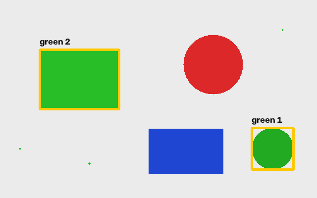

# Компьютерное зрение: от пикселя до светодиода

[](https://github.com/Semelion/small_cv_course/actions/workflows/pages.yml)

Мини-курс для учебных сборов: **две пары по 90 минут и консультации**. Продолжение вводного видео, где устанавливаются инструменты и открывается первое изображение через OpenCV.

**[Читать учебник онлайн →](https://semelion.github.io/small_cv_course/)**

В репозитории — пошаговый учебник с иллюстрациями, семь Python-примеров, задания с критериями проверки, план преподавателя и прошивка RP2040 для управления светодиодами.



## Программа

| Занятие | Темы | Результат |
|---|---|---|
| Первая пара | Матрица изображения, координаты и пиксели, обрезка, окрашивание циклом, BGR/GRAY/HSV, маски, контуры, прямоугольники и надписи | Находим цветные объекты и отмечаем их на изображении |
| Вторая пара | Поток камеры, обнаружение и отрисовка ArUco, USB Serial, RP2040 с Arduino | Видим маркеры и включаем LED командами `r`, `g`, `b` с компьютера |
| Консультации | Окружения, подбор HSV, камера, порты, проводка, расширенные задания | Разбираем ошибки и переносим обработку в видеопоток |

ArUco изучается на уровне обнаружения границ и ID: оценка позы и калибровка камеры в мини-курс не входят.

## Стек и оборудование

- Python 3, Anaconda, VS Code, NumPy, OpenCV, pyserial.
- Веб-камера и маркер из `textbook/assets/aruco_4x4_50_id7.png`.
- RP2040 с Arduino framework; пример схемы — обычный Raspberry Pi Pico.
- Три отдельных LED, по резистору 330 Ом на каждый, макетная плата, провода и USB-кабель с передачей данных.

Светодиоды подключены к **GP2, GP3, GP4**. Это номера GPIO, не номера физических контактов. Для другой платы нужно сверить распиновку. Скорость Serial в примерах — **115200**; команды `r`, `g`, `b` включают один соответствующий LED, `off` выключает все.

## Быстрый старт

```bash
git clone https://github.com/Semelion/small_cv_course.git CV_course
cd CV_course
conda create -n cv_course python=3.12 -y
conda activate cv_course
python -m pip install -r requirements.txt
```

Если окружение после вводного видео уже работает, используйте его: повторная установка не нужна. В VS Code выберите его через **Python: Select Interpreter**. Не устанавливайте несколько пакетов OpenCV в одно окружение: они предоставляют один модуль `cv2`.

**Все команды запускайте из папки `CV_course`.** Пути в примерах записаны обычными строками, например `"textbook/assets/scene.png"`. Папка для результатов уже входит в репозиторий.

Откройте [начало учебника](textbook/chapters/00_start.md), готовый `textbook/index.html` в браузере или сайт по ссылке выше.

```bash
python textbook/examples/01_pixels.py
python textbook/examples/02_colors.py
python textbook/examples/03_objects.py
python textbook/examples/04_camera.py
python textbook/examples/06_make_marker.py
python textbook/examples/05_aruco.py
python textbook/examples/07_serial_led.py
```

Перед запуском Serial загрузите `textbook/arduino/rgb_serial/rgb_serial.ino` через Arduino IDE и закройте Serial Monitor. Программа покажет порты и попросит ввести имя нужного порта, затем команды `r`, `g`, `b`, `off` или `q`.

Все семь примеров написаны последовательно, сверху вниз: без своих функций, `argparse`, `pathlib` и блока `if __name__ == "__main__"`. Номер камеры и ID маркера меняются прямо в коде. В Arduino остаются только обязательные `setup()` и `loop()`.

## Структура

```text
civic.jpeg, test.py       Исходный пример вводного урока
textbook/
  chapters/              Пошаговые главы и план преподавателя
  examples/              Самостоятельные Python-программы
  assets/                Сцена, результаты, маркер и схема подключения
  arduino/rgb_serial/    Arduino-скетч
  tools/                 Сборка HTML и проверка ссылок
  index.html             Готовый учебник для локального чтения
  CHECKS.md              Выполненные проверки и ограничения
.github/workflows/       Автосборка и публикация GitHub Pages
```

## Обновление сайта

Редактируйте `textbook/README.md` и главы в `textbook/chapters/`, добавляйте изображения в `textbook/assets/`. Каждый push в `main` запускает GitHub Actions: сборку HTML, проверку синтаксиса Python и локальных ссылок, затем публикацию GitHub Pages. Pull request запускает сборку и проверки без публикации. Также доступен ручной запуск workflow.

Локальная сборка:

```bash
python -m pip install -r requirements-site.txt
python textbook/tools/build_book.py
python textbook/tools/check_site.py
```

Для сборки сайта OpenCV и подключённая плата не нужны. GitHub Pages должен использовать источник **GitHub Actions** в Settings → Pages. Конфигурация основана на [официальной документации GitHub Pages](https://docs.github.com/en/pages/getting-started-with-github-pages/using-custom-workflows-with-github-pages).

## Проверки

Примеры обработки изображений и распознавания ArUco проверены программно; логика Serial проверена с имитацией платы. Живая камера, компиляция Arduino и физическое переключение LED требуют проверки на оборудовании перед занятием. Подробности — в [CHECKS.md](textbook/CHECKS.md).
