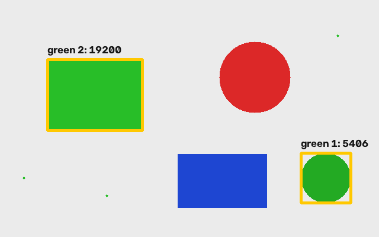

# Компьютерное зрение: от пикселя до светодиода

Учебник после вводного видео с установкой Python, Anaconda, VS Code, OpenCV и pyserial. Формат: **две пары по 90 минут + консультации**. Если пара у вас короче, переносите задания со звёздочкой на консультацию. Все примеры лежат рядом с учебником и работают локально.

**Начните с `index.html` в браузере** или читайте главы в предпросмотре Markdown в VS Code (`Ctrl+Shift+V`, на macOS `Cmd+Shift+V`). Каждый шаг: прочитать → набрать небольшой фрагмент → запустить → изменить один параметр → объяснить результат. Готовый скрипт используйте для сверки, а не вместо самостоятельного набора.

## Маршрут

1. [Как начать писать и запускать код](chapters/00_start.md).
2. [Изображение как матрица: пиксели, цвета, маски, объекты](chapters/01_images.md).
3. [Камера и ArUco](chapters/02_camera_aruco.md).
4. [Компьютер → RP2040: управление светодиодами](chapters/03_serial.md).
5. [План преподавателя и контрольные задания](chapters/04_teacher.md).

## Что получится

Вы сможете вырезать участок изображения, менять пиксели, выделять цвет маской и обводить объекты; показывать видеопоток и подписанные ArUco-маркеры; отправлять с компьютера команды `r`, `g`, `b` на плату.

## Файлы

- `examples/` — семь самостоятельных программ Python.
- `assets/` — учебная сцена, иллюстрации, маркер для показа камере, схема подключения.
- `arduino/rgb_serial/rgb_serial.ino` — прошивка Arduino для RP2040.
- `chapters/` — исходный текст учебника с фрагментами кода.
- `CHECKS.md` — что проверено программно и что требует оборудования.

Примеры используют пути относительно своего файла. Поэтому исходное изображение найдётся независимо от рабочей папки терминала. Ваши `../test.py` и `../civic.jpeg` остаются исходными материалами вводного урока.
