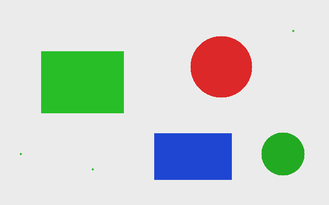
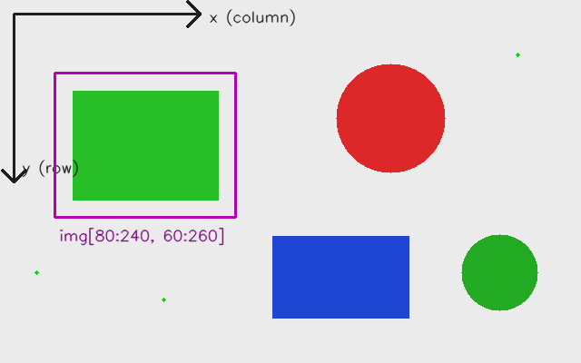
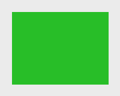
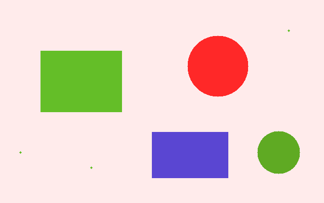
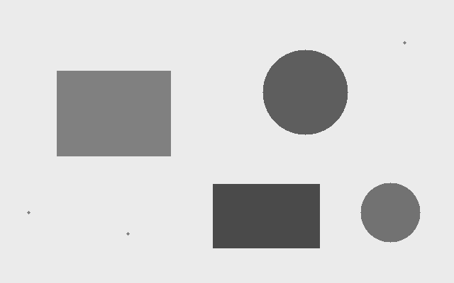
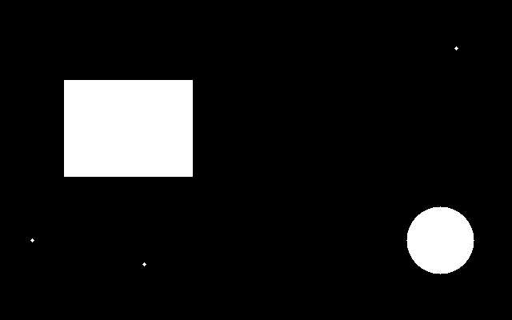
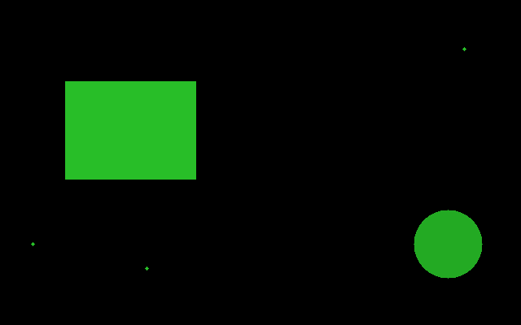
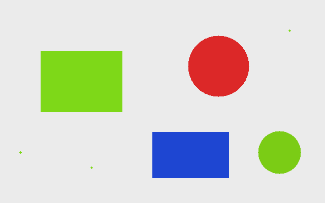
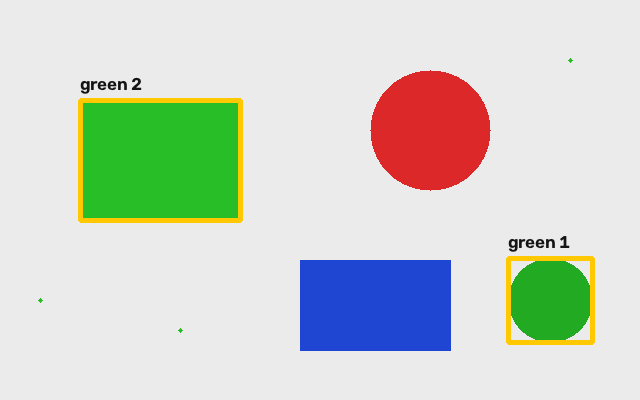

# Первая пара. От изображения к найденному объекту

За 90 минут пройдем цепочку: **массив чисел → изменение пикселей → HSV → маска → контуры → рамки и подписи**. Сначала работаем с подготовленной картинкой, чтобы у всех получился одинаковый результат. Затем переносим приемы на свои фотографии.

| Время | Что делаем | Что должно получиться |
|---|---|---|
| 0–10 мин | Создаем файл, читаем изображение, проверяем путь | Окно с картинкой |
| 10–30 мин | Размер, пиксель, обрезка, цикл | Фрагмент и красноватая картинка |
| 30–45 мин | GRAY и HSV | Серое изображение, значения HSV |
| 45–60 мин | Цветовая маска | Белые зеленые фигуры на черном фоне |
| 60–80 мин | Контуры, площадь, рамки, надписи | Две рамки с подписями |
| 80–90 мин | Самостоятельное изменение | Поиск синего или красного объекта |

## 1. Создаем свой первый рабочий файл

Открой в VS Code папку `CV_course`. Внутри `textbook/examples` создай `my_image.py`. Открой встроенный терминал **Terminal → New Terminal**. Выбери тот же Python-интерпретатор, в котором на вводном уроке работал `import cv2`: команда **Python: Select Interpreter** в палитре команд VS Code. Если терминал уже был открыт до смены интерпретатора, открой новый и активируй нужное conda-окружение.

Вставь код ниже и сохрани файл. Для запуска из папки курса набери `python textbook/examples/my_image.py`. Терминал должен находиться в `CV_course`; это видно в приглашении или по команде `pwd` (PowerShell: `Get-Location`). Путь к картинке отсчитывается от папки терминала: запускайте из CV_course.

```python
import cv2 as cv

img = cv.imread('textbook/assets/scene.png')
if img is None:
    raise FileNotFoundError('Не удалось прочитать assets/scene.png')

cv.imshow('image', img)
cv.waitKey(0)
cv.destroyAllWindows()
```

`import` подключает библиотеку, `as cv` задает короткое имя. Переменная `img` хранит изображение. Строка `"textbook/assets/scene.png"` — путь к картинке от папки CV_course. `waitKey(0)` ждет нажатия клавиши в окне OpenCV. Чтобы закрыть пример, щелкни по окну и нажми любую клавишу.

Следующие фрагменты добавляй **перед `imshow`**, а в `imshow` передавай нужную переменную. Готовые версии уже лежат в `examples/01_pixels.py`, `02_colors.py`, `03_objects.py`. В них несколько окон; каждое показывает свой этап.



**Проверка:** исходная сцена размером 640×400 пикселей. Зеленых крупных фигур две; маленькие точки специально понадобятся для фильтрации помех.

## 2. Изображение — массив

```python
print(img.shape)  # (400, 640, 3)
print(img.dtype)  # uint8
height, width = img.shape[:2]
print(height, width)
```

`shape` сообщает **высоту, ширину и число каналов**, именно в этом порядке. `uint8` хранит целое число от 0 до 255. Один цветной пиксель содержит три числа. OpenCV обычно читает цветное изображение в порядке **B, G, R**: синий, зеленый, красный. Черный — `(0, 0, 0)`, белый — `(255, 255, 255)`, чистый красный — `(0, 0, 255)`.

В массиве сначала указывают строку `y`, затем столбец `x`. Начало координат находится в левом верхнем углу; `x` растет вправо, `y` вниз. Индексация начинается с нуля: последний допустимый `x` здесь равен 639, `y` — 399.

```python
print(img[120, 100])     # Пиксель x=100, y=120: [40 190 40].
print(img[120, 100, 1])  # Только зеленый канал: 190.
changed = img.copy()
changed[120, 100] = (255, 255, 255)
changed[115:126, 95:106] = (255, 255, 255)  # Уже заметный квадрат.
```

`copy()` создает независимое изображение. Простое `changed = img` даст другое имя тому же массиву: изменение одного изменит другое.



**Попробуй:** закрась квадрат 30×30 в синий. Проверь, что изменилось бы при перестановке `x` и `y`.

## 3. Обрезка: выбираем область интереса

```python
crop = img[80:240, 60:260].copy()
print(crop.shape)  # (160, 200, 3)
cv.imshow('crop', crop)
```

Запись `[y1:y2, x1:x2]` берет строки от `y1` до `y2 − 1` и столбцы от `x1` до `x2 − 1`. Правая граница не включается. Поэтому высота равна `240 − 80`, ширина — `260 − 60`. Такой фрагмент часто называют ROI, областью интереса. Без `.copy()` срез обычно связан с исходным массивом: закрашивая его, ты изменишь и оригинал.



**Попробуй:** вырежи красный круг целиком. Ожидаемый размер фрагмента сначала посчитай на бумаге, затем проверь через `shape`. Если окно не открывается, проверь, не получился ли пустой срез из-за перепутанных границ.

## 4. Проходим по всем пикселям и добавляем красный

```python
tinted = img.copy()
for y in range(height):
    for x in range(width):
        b, g, r = img[y, x]
        tinted[y, x] = (int(b), int(g), min(255, int(r) + 60))
```

`range(height)` перебирает номера строк; для каждой строки внутренний цикл перебирает все столбцы. Отступы задают вложенность: последняя строка выполняется для каждого пикселя. Мы сохраняем B и G, а R увеличиваем на 60. `int(r)` сначала переводит значение в обычное целое Python; `min(255, ...)` ограничивает результат. Например, из R=220 получается 255, а не число за пределами `uint8`.



### Дополнительно: ускоряем обработку

Этот фрагмент можно оставить на консультацию; в основном скрипте используется понятный цикл. Для больших изображений применяют операцию над целым каналом NumPy:

```python
import numpy as np

fast = img.copy()
red = img[:, :, 2].astype(np.int16)
fast[:, :, 2] = np.clip(red + 60, 0, 255).astype(np.uint8)
print(np.array_equal(tinted, fast))  # True
```

Двоеточие означает «все строки» или «все столбцы». Временный `int16` позволяет безопасно получить числа больше 255. `clip` ограничивает диапазон, затем мы возвращаем тип `uint8`. Выражение `img[:, :, 2] + 60` прямо в `uint8` может переполниться: арифметика массива не обязана насыщаться на 255.

**Попробуй:** добавь синий оттенок, затем полностью обнули красный канал. Объясни разницу между «увеличить R» и «заменить каждый пиксель красным».

## 5. Меняем цветовое пространство

```python
gray = cv.cvtColor(img, cv.COLOR_BGR2GRAY)
hsv = cv.cvtColor(img, cv.COLOR_BGR2HSV)
print(gray.shape)  # (400, 640)
print(hsv[120, 100])  # [60 201 190]
```

GRAY хранит по одному значению яркости на пиксель. Цвет теряется, размер изображения в пикселях сохраняется. Это результат преобразования с весами для каналов, а не выбор одного из B, G или R.



HSV разделяет **H — оттенок**, **S — насыщенность**, **V — значение яркости**. Для обычного 8-битного `COLOR_BGR2HSV` в OpenCV H лежит в диапазоне **0–179**, S и V — **0–255**. Примерные оттенки: красный около 0 и 179, зеленый около 60, синий около 120. У серого насыщенность мала; его H не помогает определить цвет.

Не показывай `hsv` через обычный `imshow` как цветную картинку: окно интерпретирует три канала как BGR, и цвета будут неверными. Можно показать отдельные каналы как серые изображения:

```python
h, s, v = cv.split(hsv)
cv.imshow('H channel', h)
```

**Попробуй:** сравни BGR и HSV пикселей из зеленой фигуры и серого фона. Что лучше отделяет их друг от друга?

## 6. Маска: задаем условие для каждого пикселя

```python
mask = cv.inRange(hsv, (40, 80, 60), (85, 255, 255))
selected = cv.bitwise_and(img, img, mask=mask)
```

`inRange` проверяет сразу три компоненты HSV. Пиксель попадает в маску, если **40 ≤ H ≤ 85, 80 ≤ S ≤ 255 и 60 ≤ V ≤ 255**. Нижняя и верхняя границы включены. Маска — одноканальный массив: 255 означает «выбран», 0 — «не выбран». Порог S убирает серый фон, порог V — слишком темные области.



В `bitwise_and` исходное изображение подано дважды, поэтому цвет остается прежним в выбранных местах; остальные становятся черными.



Если нужно именно **наложить** цветную маску поверх исходника, сделай полупрозрачную подсветку:

```python
overlay = img.copy()
overlay[mask > 0] = (0, 255, 255)  # Желтая подсветка выбранного.
overlay = cv.addWeighted(img, 0.6, overlay, 0.4, 0)
```



Порог — гипотеза о цвете, а не универсальный детектор. На фотографии он зависит от освещения, теней и камеры. Для красного часто нужны два интервала по H: например, 0–10 и 170–179, затем объединение двух масок через `cv.bitwise_or(mask1, mask2)`.

**Попробуй:** поставь для синего H от 100 до 130 при тех же ограничениях S и V. Должен остаться один синий прямоугольник.

## 7. Из маски получаем контуры

```python
contours, hierarchy = cv.findContours(
    mask, cv.RETR_EXTERNAL, cv.CHAIN_APPROX_SIMPLE
)
result = img.copy()
count = 0
for contour in contours:
    area = cv.contourArea(contour)
    if area < 500:
        continue
    count += 1
    x, y, w, h = cv.boundingRect(contour)
    cv.rectangle(result, (x, y), (x + w - 1, y + h - 1), (0, 200, 255), 3)
    cv.putText(result, 'green ' + str(count), (x, y - 10),
               cv.FONT_HERSHEY_SIMPLEX, 0.6, (20, 20, 20), 2, cv.LINE_AA)
```

Контур описывает границу белой области. `RETR_EXTERNAL` берет только внешние границы, `CHAIN_APPROX_SIMPLE` сокращает лишние точки на прямых участках. На вход передаем бинарную маску, не цветное изображение. `hierarchy` содержит отношения контуров; в этой задаче она не нужна.

`contourArea` вычисляет геометрическую площадь контура в квадратных пикселях: это не обязательно точное число белых пикселей. `continue` пропускает мелкие точки. Порог 500 подобран для учебной картинки и при другом масштабе может потребовать изменения.

`boundingRect` возвращает левый верхний угол `(x, y)` и размеры `(w, h)`. В функции рисования точки задаются в порядке **(x, y)**, тогда как доступ к массиву был **[y, x]**. Конечная точка рамки — `(x + w - 1, y + h - 1)`, чтобы соответствовать пикселям области.

`putText` рисует строку на изображении. Точка задает начало строки на ее базовой линии. `0.6` — масштаб шрифта, `2` — толщина, `LINE_AA` сглаживает края. Стандартный шрифт OpenCV плохо подходит для кириллицы, поэтому здесь подписи латиницей. Функции рисования изменяют переданное изображение; работаем с `result`, сохраняя оригинал.



**Ожидаемый результат:** две рамки. Для прямоугольника площадь контура 19200, рамка `(80, 100, 161, 121)`; для круга площадь 5406, рамка `(508, 258, 85, 85)`. Порядок обхода контуров не является устойчивым ID объекта.

## 8. Дополнительно: очищаем маску

Мелкие точки можно убрать до поиска контуров:

```python
import numpy as np

kernel = np.ones((5, 5), np.uint8)
mask = cv.morphologyEx(mask, cv.MORPH_OPEN, kernel)
```

Морфологическое открытие сначала сужает белые области, затем расширяет их. Тонкие помехи исчезают, но реальные маленькие объекты тоже могут потеряться. Это отдельный прием; для основной задачи достаточно фильтра по площади. Чтобы попробовать, добавь этот фрагмент после создания маски, перед поиском контуров.

## 9. Самостоятельная работа и контроль

1. Измени программу так, чтобы искать только синий прямоугольник, подписывая его `blue`.
2. Найди красный круг, объединив две маски по H. Объясни, зачем нужны два интервала.
3. Сохрани результат через `cv.imwrite('my_result.png', result)` и найди файл в текущей папке терминала.
4. Заменив учебную сцену своей фотографией, подбери цветовые границы. Для существующего `civic.jpeg` напиши `img = cv.imread("civic.jpeg")`, запуская из CV_course. Рамка по цвету выделит цветную область, но сама по себе не распознает автомобиль как смысловой объект.

Запускай готовые примеры по очереди из папки `CV_course`:

```sh
python textbook/examples/01_pixels.py
python textbook/examples/02_colors.py
python textbook/examples/03_objects.py
```

Результаты записываются в `textbook/assets/generated`. Повторный запуск обновляет соответствующие PNG. Чтобы завершить пример, щелкни по окну OpenCV и нажми любую клавишу.

**Можешь объяснить своими словами?** Почему `img[20, 80]` и `(80, 20)` описывают один пиксель? Почему нужен `copy()`? Чем HSV отличается от маски? Почему зеленая пыль не получила рамку? Какие параметры надо менять при переходе к реальной фотографии?

## Если что-то пошло не так

| Симптом | Что проверить |
|---|---|
| `ModuleNotFoundError: cv2` | Выбран ли интерпретатор с вводного урока, совпадает ли он с Python терминала? |
| `img is None` / ошибка чтения | Существует ли файл, правильно ли названа папка `assets`, не опечатано ли расширение? |
| `IndexError` | Не перепутаны ли x/y, не выходит ли индекс за размер изображения? |
| Пустое окно обрезки | Верхние границы больше нижних? Срез имеет ненулевые высоту и ширину? |
| Красный выглядит синим | В OpenCV кортеж задается в порядке BGR. |
| Маска полностью черная | Диапазоны заданы для HSV? Перед `inRange` выполнен `cvtColor`? |
| Маска полностью белая | Не слишком ли широкие границы S/V/H? |
| Рамок очень много | Отфильтруй маленькую площадь, затем при необходимости очисти маску. |

Описание API сверено с официальными материалами OpenCV: [операции с изображениями](https://docs.opencv.org/4.x/d3/df2/tutorial_py_basic_ops.html), [цветовые пространства](https://docs.opencv.org/4.11.0/df/d9d/tutorial_py_colorspaces.html), [inRange](https://docs.opencv.org/4.x/da/d97/tutorial_threshold_inRange.html), [свойства контуров](https://docs.opencv.org/4.x/dd/d49/tutorial_py_contour_features.html), [рисование](https://docs.opencv.org/4.x/dc/da5/tutorial_py_drawing_functions.html). Иллюстрации созданы для курса; это результаты прилагаемых программ на синтетической сцене.
