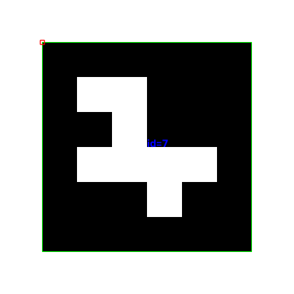

# 2. Камера и ArUco: от картинки к потоку

**Цель:** показать живое видео, найти квадратный маркер и обвести его границу с ID. На эту часть второй пары отведём 35 минут: 15 минут на камеру и 20 на маркеры.

Команды ниже запускаем из `CV_course/textbook` в терминале VS Code, с тем же Python, которым открывали картинку. Полные программы лежат в `examples`; фрагменты в тексте показывают главное.

## 2.1. Кадр — та же матрица

В фотографии матрица загружается один раз. В видео камера выдаёт новую матрицу на каждой итерации цикла. Значит, уже знакомые обрезка, маска, контуры и надписи применимы и к кадру.

```python
import cv2 as cv

cap = cv.VideoCapture(0)
try:
    if not cap.isOpened():
        raise RuntimeError('Камера не открылась')
    while True:
        ok, frame = cap.read()
        if not ok:
            raise RuntimeError('Кадр не получен')
        cv.imshow('Camera', frame)
        if cv.waitKey(1) & 0xFF in (ord('q'), 27):
            break
finally:
    cap.release()
    cv.destroyAllWindows()
```

`0` — индекс камеры, а не номер USB-порта. `read()` возвращает два значения: получилось ли чтение и сам кадр. Сначала проверяем `ok`, затем используем `frame`. `while True` повторяет чтение, а `break` завершает цикл. Блок `finally` освобождает камеру даже при ошибке.

`waitKey(1)` позволяет окну обновляться и обрабатывает клавиши; это не обещание частоты 1000 кадров/с. Задержка `0`, знакомая по статической картинке, остановила бы цикл до нажатия клавиши. Для выхода нажми **Q в английской раскладке или Esc**, когда окно видео активно. [Документация OpenCV о видео](https://docs.opencv.org/4.x/dd/d43/tutorial_py_video_display.html).

Запусти готовую программу:

```bash
python examples/04_camera.py --camera 0
```

**Ожидаем:** открывается окно, движения отображаются непрерывно, Esc закрывает окно и освобождает камеру.

**Попробуй сам, 3 минуты.** Перед `imshow` вставь:

```python
gray = cv.cvtColor(frame, cv.COLOR_BGR2GRAY)
cv.imshow('Gray', gray)
```

Появятся цветное и серое видео. Объясни соседу, почему `cvtColor` находится внутри цикла. Затем удали дополнительное окно перед следующим упражнением.

## 2.2. Что такое ArUco

ArUco — квадратный чёрно-белый маркер с числовым идентификатором. Мы используем словарь `DICT_4X4_50`: внутри маркера сетка 4 × 4 бит, в словаре 50 ID, от 0 до 49. Чёрная рамка входит в маркер; снаружи оставляем белое поле. Словарь при создании и при поиске должен совпадать.

В этом упражнении результат — четыре угла и ID. Мы только рисуем найденные маркеры; расстояние, пространственное положение и калибровку камеры не рассматриваем.

## 2.3. Сначала изготовим маркер

Запусти:

```bash
python examples/06_make_marker.py --id 7
```

Получится `assets/aruco_4x4_50_id7.png`:


Распечатай его на белой бумаге или покажи на другом экране. Не обрезай белое поле и чёрную рамку. При демонстрации с экрана избегай бликов и слишком маленького размера.

Главные строки генератора:

```python
dictionary = cv.aruco.getPredefinedDictionary(cv.aruco.DICT_4X4_50)
marker = cv.aruco.generateImageMarker(dictionary, 7, 300)
printable = cv.copyMakeBorder(
    marker, 60, 60, 60, 60, cv.BORDER_CONSTANT, value=255
)
cv.imwrite('marker.png', printable)
```

Здесь `300` — размер стороны в пикселях. Функция `copyMakeBorder` добавляет по 60 белых пикселей с каждой стороны. Генератор в комплекте сохраняет файл в папку `assets`, независимо от текущей рабочей папки.

## 2.4. Детектор создаём один раз, ищем в каждом кадре

Перед циклом камеры подготовь словарь и детектор:

```python
dictionary = cv.aruco.getPredefinedDictionary(cv.aruco.DICT_4X4_50)
parameters = cv.aruco.DetectorParameters()
detector = cv.aruco.ArucoDetector(dictionary, parameters)
```

Внутри цикла, после успешного `cap.read()`, добавь:

```python
corners, ids, rejected = detector.detectMarkers(frame)
if ids is not None:
    cv.aruco.drawDetectedMarkers(frame, corners, ids)
cv.imshow('ArUco', frame)
```

`corners` содержит углы распознанных маркеров, `ids` — их номера. Когда распознанных маркеров нет, `ids` равно `None`: это обычный результат, а не ошибка. `rejected` — кандидаты, не прошедшие проверку; в уроке их не используем. `drawDetectedMarkers` изменяет переданное изображение, обводит маркеры и подписывает ID. [Официальный пример OpenCV](https://docs.opencv.org/4.12.0/d5/dae/tutorial_aruco_detection.html).

Готовая программа сохраняет исходный кадр, рисуя на его копии:

```bash
python examples/05_aruco.py --camera 0
```

Поднеси маркер к камере. **Ожидаем:** контур следует за его четырьмя сторонами, рядом виден номер `7`; если убрать маркер, контур исчезает. Не зеркаль кадр перед распознаванием: зеркальная картинка меняет код маркера.

Вот реальный результат запуска того же детектора на подготовленном файле, а не снимок с физической камеры:



## 2.5. Проверка без камеры

Если камера пока недоступна, проверь алгоритм на файле:

```bash
python examples/05_aruco.py --image assets/aruco_4x4_50_id7.png --no-gui
```

В терминале должно быть `Найденные ID: [7]`, а результат появится в `assets/aruco_detected.png`. Это проверяет генерацию и распознавание, но не работу физической камеры или оконной системы.

**Задание, 5 минут.** Создай ID `12`, покажи камере два маркера одновременно и добейся двух контуров с правильными номерами. Затем наклони лист и постепенно отдаляй его: в какой момент распознавание пропадает? Назови два фактора, которые влияют на результат.

**Проверка понимания:** где создаётся детектор — до цикла или внутри? Почему надо проверять `ids is not None`? Что случится, если словари генератора и детектора различаются?

## Если что-то не работает

| Симптом | Что проверить |
|---|---|
| Камера не открывается | Закрыть видеосвязь и другие приложения с камерой, разрешить доступ для приложения, из которого запущен Python; попробовать `--camera 1`. |
| Окно не отвечает | В цикле должен вызываться `waitKey(1)`. Клавиши нажимаются в активном окне видео. |
| `cv2` не найден | VS Code и терминал должны использовать одно окружение Python. |
| Нет `aruco` или `ArucoDetector` | Проверить `python -c "import cv2; print(cv2.__version__); print(cv2.__file__)"`. Примеры проверены на OpenCV 4.12.0 и в окружении курса с OpenCV 5.0.0. Старые примеры с иным API не смешивать с этим кодом. |
| Ошибка `imshow`, функция не реализована | Для этих уроков нужна оконная сборка, не `headless`. |
| Маркер виден, но контура нет | Проверить словарь, белое поле, резкость, свет, размер и отсутствие перекрытия рамки. |

Для единого окружения курса выбран пакет **`opencv-contrib-python`**. Это одна поставка `cv2`; не устанавливай рядом `opencv-python`, `opencv-python-headless` или `opencv-contrib-python-headless`. В современных версиях ArUco может присутствовать и в основной сборке, но смешивать пакеты нельзя: они используют одно имя `cv2`. Если проверка API проходит, переустановка не нужна. Если обнаружены конфликтующие pip-пакеты, преподаватель поможет удалить дубликаты и оставить одну оконную поставку.

Если OpenCV был установлен через conda, используй отдельное окружение курса по инструкции из начала учебника, чтобы не смешивать менеджеры для одной библиотеки. [Правила установки от сопровождающих пакета](https://github.com/opencv/opencv-python#installation-and-usage).
