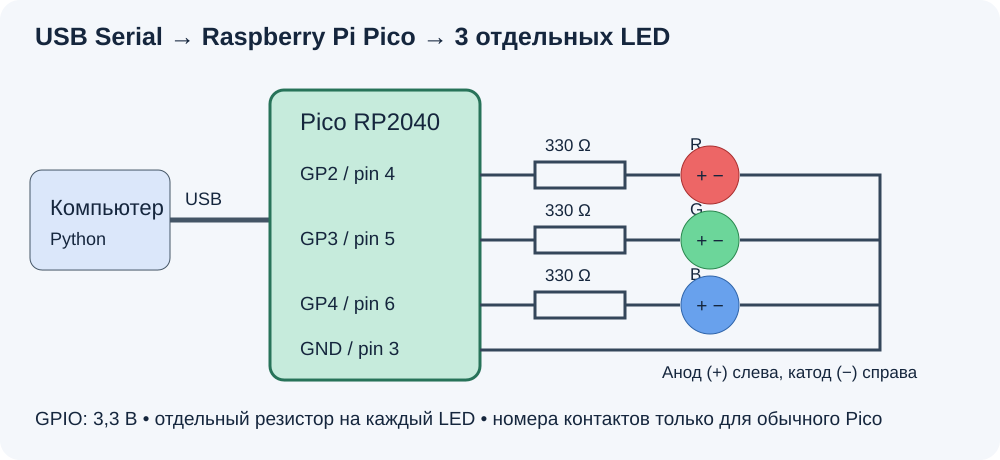

# 3. Зажигаем светодиод с компьютера

Введём в Python букву `r`, `g` или `b`, а плата зажжёт красный, зелёный или синий светодиод. `off` выключит все светодиоды. `q` выключит их и завершит программу.

## Собираем схему

В примере используется **обычная Raspberry Pi Pico с RP2040** и три отдельных внешних светодиода. У другой платы на RP2040 расположение контактов может отличаться. Встроенный RGB здесь не используется.

Нужны три LED, три резистора 220–330 Ом (на рисунке 330 Ом), провода, макетная плата и USB-кабель с передачей данных. Собирайте схему при отключённом питании. У каждого LED должен быть **свой резистор**.



| Цвет | GPIO в программе | Физический контакт обычного Pico | Подключение |
|---|---:|---:|---|
| Красный | 2 | 4 | GP2 → резистор → анод LED |
| Зелёный | 3 | 5 | GP3 → резистор → анод LED |
| Синий | 4 | 6 | GP4 → резистор → анод LED |
| Общая земля | GND | 3 | Все катоды → GND |

Обычно длинная ножка LED — анод (+), короткая — катод (−). Если ножки обрезаны, проверьте маркировку. **Номер GPIO не равен номеру физического контакта.** Сверяйтесь с [распиновкой Pico](https://www.raspberrypi.com/documentation/microcontrollers/pico-series.html). Логика GPIO — 3,3 В; не подавайте на GPIO 5 В.

Схема рассчитана на отдельные LED. RGB с общим анодом требует другого подключения и обратной логики; адресный WS2812 — другой программы. Для урока используем именно три обычных LED.

## Загружаем программу Arduino

Используем Arduino framework и пакет плат **Arduino-Pico от Earle Philhower**. В настройках Arduino IDE добавьте адрес в Additional Boards Manager URLs:

```text
https://github.com/earlephilhower/arduino-pico/releases/download/global/package_rp2040_index.json
```

Установите пакет плат через Boards Manager и выберите Raspberry Pi Pico (или точную модель своей платы). Оставьте стандартный USB Stack Arduino. Откройте `arduino/rgb_serial/rgb_serial.ino` из папки учебника.

Для первой загрузки удерживайте BOOTSEL при подключении USB, затем отпустите кнопку. Выберите UF2 Board, если он предлагается в меню порта, и нажмите Upload. После загрузки выберите появившийся последовательный порт. [Инструкция Arduino-Pico](https://arduino-pico.readthedocs.io/en/stable/install.html).

В Arduino нужны две обязательные функции: **`setup()` и `loop()`**. Их вызывает сам framework: `setup()` один раз после включения, а `loop()` — снова и снова. Других функций в нашем скетче нет.

```cpp
void setup() {
  pinMode(2, OUTPUT);
  pinMode(3, OUTPUT);
  pinMode(4, OUTPUT);
  digitalWrite(2, LOW);
  digitalWrite(3, LOW);
  digitalWrite(4, LOW);
  Serial.begin(115200);
  Serial.setTimeout(100);
}
```

`OUTPUT` делает контакт выходом. `HIGH` включает LED, `LOW` выключает. Вначале все LED выключены. `Serial.begin(115200)` запускает связь. `setTimeout(100)` ограничивает ожидание недостающих символов 100 миллисекундами.

Внутри `loop()` проверяем, пришли ли данные, и читаем строку:

```cpp
if (Serial.available() > 0) {
  String command = Serial.readStringUntil('\n');
  command.trim();
  // Дальше сравниваем command с r, g, b и off.
}
```

`\n` — конец строки. `trim()` убирает пробелы и служебные символы по краям. Для красного цвета выполняется такая ветка:

```cpp
if (command == "r") {
  digitalWrite(2, HIGH);
  digitalWrite(3, LOW);
  digitalWrite(4, LOW);
  Serial.println("OK r");
}
```

Остальные ветки найдите в полном скетче: они явно включают нужный GPIO и выключают два других. Ответ `OK r` означает, что плата обработала команду. Неизвестная команда получает ответ `ERR command`.

Проверьте скетч в Serial Monitor: скорость **115200**, окончание строки **Newline**. Отправьте `r`, затем `g`, затем `off`. После проверки **закройте Serial Monitor**, чтобы Python смог открыть порт.

## Пишем Python сверху вниз

Откройте `examples/07_serial_led.py`. В этом файле нет собственных функций: команды выполняются по порядку.

```python
import time
import serial
from serial.tools import list_ports

for port in list_ports.comports():
    print(port.device, port.description)

port_name = input("Введите порт платы: ").strip()
board = serial.Serial(port_name, 115200, timeout=1, write_timeout=2)
time.sleep(2)
```

Цикл печатает доступные порты. Введите имя порта платы: например, `COM5`, `/dev/cu.usbmodem1101` или `/dev/ttyACM0`. Это примеры — ваше имя берём из списка. Можно сравнить список до и после подключения платы.

`timeout=1` ограничивает чтение одной секундой, `write_timeout=2` — ожидание отправки двумя секундами. `sleep(2)` даёт плате время после открытия порта. Если она запускается дольше, первая команда может остаться без ответа — повторите её после запуска.

Сама отправка занимает одну строку:

```python
board.write((command + "\n").encode("ascii"))
```

Добавляем конец строки и превращаем текст в байты. Плата читает строку до этого конца. Ответ превращаем обратно в текст:

```python
answer = board.readline().decode("ascii").strip()
if answer:
    print(answer)
else:
    print("Нет ответа за 1 секунду. Проверьте порт и прошивку.")
```

Пустой ответ означает, что за отведённое время не получили строку. Это не подтверждение выполнения команды. [Чтение и таймауты pySerial](https://pyserial.readthedocs.io/en/latest/pyserial_api.html).

В `while True` программа снова и снова спрашивает команду. `continue` пропускает неправильный ввод, `break` заканчивает цикл. При `q` программа отправляет `off`, читает ответ и выходит. Блок `finally` выполняет `board.close()`, даже если возникла ошибка. Для обычного завершения используйте `q`: закрытие порта само по себе не выключает LED.

## Запускаем

В терминале VS Code выберите окружение курса. Если pySerial отсутствует, выполните `python -m pip install pyserial`. Из папки `textbook` запустите:

```bash
python examples/07_serial_led.py
```

Ожидаемый диалог (имя порта будет вашим):

```text
Введите порт платы: COM5
r / g / b / off / q: r
OK r
r / g / b / off / q: g
OK g
r / g / b / off / q: b
OK b
r / g / b / off / q: q
OK off
```

На обеих сторонах стоит **115200**. Здесь используется USB Serial, а не отдельный UART-переходник. У выбранного core USB `Serial` не меняет физическую скорость USB от baudrate; для аппаратного UART `Serial1` скорость уже имеет прямое значение. [Документация Arduino-Pico Serial](https://arduino-pico.readthedocs.io/en/stable/serial.html).

## Проверь себя

1. Переключи r → g → b. Предыдущий LED должен гаснуть.
2. Введи `off`, затем снова `r`. Для смены цвета перепрошивка не нужна.
3. Введи неизвестное слово. Python должен предложить правильные команды.
4. Объясни, зачем отправлять `\n` и читать ответ платы.
5. Для консультации: добавь `all` в Python и Arduino, чтобы включать все три LED.

## Если не получилось

| Что произошло | Что проверить |
|---|---|
| Нет модуля `serial` | Установлен ли `pyserial` в выбранном окружении? Не называйте свой файл `serial.py`. |
| Порта платы нет | USB-кабель передаёт данные? Загружен скетч? Режим BOOTSEL — не обычный serial-порт. |
| Порт занят | Закройте Serial Monitor и другие программы, использующие плату. |
| Нет ответа | Верный порт, актуальная прошивка, плата успела запуститься. |
| Ответ есть, LED не горит | При отключённом питании проверьте полярность, резистор, GPIO и GND. |

Перед занятием преподавателю нужно проверить компиляцию скетча под конкретную плату и переключение физических LED. Программная проверка без платы этого не заменяет.
